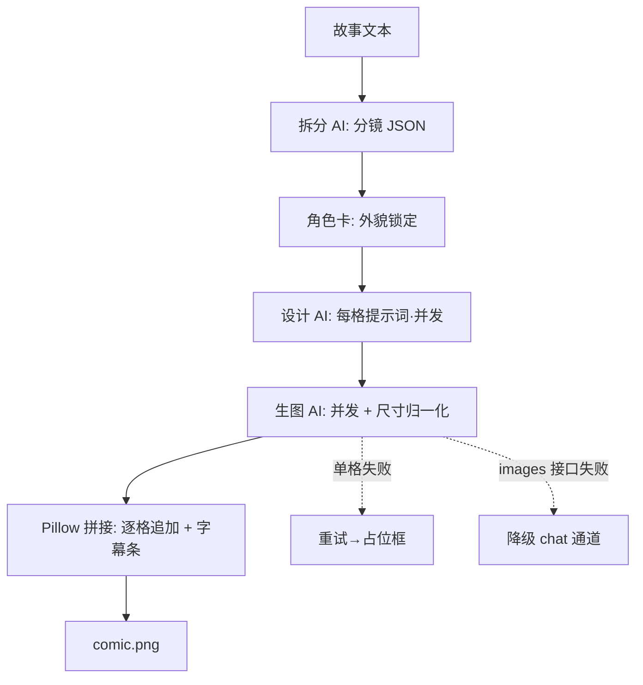

# 01_漫画生成

> 简要一句话:为 **想把一段文字变成漫画的人** 解决 **"手动拆分镜、写提示词、生图、拼图"全流程自动化** 的问题——文本进,条漫出。

## 1 · 业务诉求与边界
- 一句话:一段故事文本 → 自动拆分镜 → 每格细控提示词 → 生图 → 按顺序拼成条漫长图。
- 输入触发:CLI 一次性任务(`python -m app.main 故事.txt`)。
- 输出交付:`out/comic.png`(条漫)+ `out/panels/*.png`(单格)+ `out/state.json`(结构化状态,支持续跑)。
- 不做:交互式对话生成、流式、批量任务队列、Web 界面、彩色漫画/多画幅(可按需扩 config)。
- 成功标准(质量/时延/成本/可接受度):
  - 4 格全流程 ≤ 2 分钟(live 实测 31.9s)
  - 跨格角色外貌一致(角色卡锁定)、风格统一(风格锚)
  - 单格失败不炸全流程(占位框 + 断点续跑)
  - 离线测试 36 个全绿,零 API 消耗

## 2 · 输入与触发
- 触发源:命令行(手动 / 脚本 / 计划任务)。
- 输入数据结构:UTF-8 纯文本故事文件(或 `--demo` 内置故事);`--panels N` 控格数。
- 格式约束:任意中文/英文叙述文本;建议 ≥ 50 字保证分镜有料。

## 3 · 输出与交付
- 输出形态:竖排条漫 PNG(每格 = 图片 + 底部字幕条:编号 + 台词);`state.json` 记录每格分镜/提示词/文件。
- 交付对象:创作者本人 / 下游排版。
- 对下游影响:单格 PNG 可单独重生成后重拼;state.json 可审计每格用的提示词。

## 4 · 流程图
见 `流程图.mmd`:



## 5 · 节点定义表
| 节点 | 类型 | 输入 | 输出 | 模型/工具 | 自研/复用 |
|---|---|---|---|---|---|
| 拆分 splitter | 处理 | 故事文本 | 分镜 JSON×N | grok-chat-fast | 自研(prompt+容错解析) |
| 台词优化 polish_captions | 处理 | 全部分镜 | 每格漫画式短字幕 | grok-chat-fast | 自研(修复台词为空/啰嗦) |
| 角色卡 designer.build_character_sheet | 处理 | 全部分镜 | 外貌锁定卡 | grok-chat-fast | 自研 |
| 设计 designer.design_all | 处理(并发) | 分镜+风格锚+角色卡 | 英文生图提示词 | grok-chat-fast | 自研 |
| 提示词质检 critic.review_prompt | 处理(并发) | 提示词 vs 分镜 | 通过 / 问题反馈→重设计 | grok-chat-fast | 自研 |
| 生图 illustrator | 处理(并发) | 提示词+尺寸 | panel_NN.png | grok-imagine-image-quality-lite | 自研(OpenAI images 协议) |
| 启发式质检 critic.review_image_heuristic | 处理 | 落盘图片 | 通过 / 废图→重生成 | Pillow | 自研(损坏/尺寸/空白检测) |
| 视觉评分 critic.review_image_vision(预留) | 处理 | 图片+提示词 | 评分→重生成 | critic.vision_model(端点暂无视觉模型) | 自研 |
| 拼接 assembler | 输出 | 单格图+字幕 | comic.jpg(JPEG q90) | Pillow | 复用(库)+自研(布局) |

## 6 · 模型与调用点
| 调用点 | 模型厂家/型号 | 温度 | Token 上限 | 备注 |
|---|---|---|---|---|
| 拆分 | grok-chat-fast | 0.3(重试降到 0) | 默认 | 强制 JSON 数组输出 |
| 角色卡 | grok-chat-fast | 0.2 | 默认 | 一次调用 |
| 每格设计 | grok-chat-fast | 0.4 | 默认 | 并发 4(可配) |
| 生图 | grok-imagine-image-quality-lite | — | — | images/generations;1024x1024 统一尺寸;实测返回 960→代码归一化 resize |

## 7 · 工具与集成
| 工具名 | 形态 | 提供能力 | 自研/第三方 | 备注 |
|---|---|---|---|---|
| OpenAI 兼容代理 | HTTP | 聊天 + 生图统一入口 | 第三方 | 凭据在 .env;生图失败自动降级 chat 通道 |
| Pillow | Python 库 | 图片归一化/拼接/字幕 | 第三方(MIT) | 中文字体自动挑选 msyh/simhei |

## 8 · 异常与降级
| 异常情形 | 检测方式 | 降级动作 | 是否需要人工兜底 |
|---|---|---|---|
| 拆分输出非法 JSON | 容错解析失败 | 降温(0.3→0)重试 1 次;仍失败→error | 是(改写故事或减格数) |
| 分镜数量不符 | parse 校验 | 同上重试 | 是 |
| images 接口失败 | HTTP ≥400 | 自动降级 chat 通道提取图片 URL | 否 |
| 单格生图失败 | 重试耗尽 | 该格渲染占位框,status=partial;续跑只补失败格 | 可选(重跑即补) |
| 返回尺寸与请求不符 | 尺寸比对 | LANCZOS resize 归一化 | 否 |
| 进程中断 | state.json | 重跑自动跳过已生图格(省生图费) | 否 |

## 9 · 人工介入触发点
- 触发节点:status=error(拆分彻底失败)/ partial(个别格失败)。
- 审批人 / SLA:创作者本人,即时处理。
- 介入后的数据回流:改 `--panels` 减格数或修改故事文本重跑;失败格直接重跑同命令即续。

## 10 · 安全与合规
- 数据脱敏:故事文本只发往自配代理端点;不落第三方日志。
- PII 处理:输出仅本机文件。
- 日志留存策略:CLI 只打印 report;无持久日志(可按需加)。
- 所用项目的许可证影响:Pillow 为 MIT-CMU 宽松许可;代理端点为用户自配服务。

## 11 · 可观测性与评估
- trace 埋点:state.json 每格记录 scene/prompt/image_file;report 输出 failed_indexes 与 duration_s。
- 关键指标(质量/延迟/成本):单格生图成功率、全流程时长、格数。
- 回归用例集:见 `用例集.md`;自动化 `uv run pytest`(36 用例,离线)。

## 12 · 部署形态
- 自托管 / 云:本机 Python CLI,无服务形态。
- 容器拓扑:—(单进程)。
- 依赖项:Python ≥ 3.11;httpx、pydantic、pydantic-settings、pyyaml、Pillow(uv 管理)。
- 最低资源:可忽略;瓶颈在生图 API 延迟与并发。

## 13 · 成本与限流
- 单次 Token 预算:拆分+设计 ≈ 5 次聊天调用;生图 N 格(images 接口按张计费)。
- 并发上限:设计 4 / 生图 2(config 可调,防服务商限流)。
- 速率限制:依赖代理端点自身限制;生图并发默认保守。
- 月度预算:未内建;断点续跑防重复生图浪费。

## 14 · 选型依据
- 主力项目 + 一句话理由:**自研轻量流水线**——四阶段顺序清晰、无状态分支循环,用不上 LangGraph 状态机;直连 OpenAI 兼容代理(httpx,同 model_gateway 的 openai_compat 模式)。
- 备选项目:ComfyUI 类节点编排(视觉流水线,重且需 GUI 服务)、Dify/Langflow(可视化,过重);索引中多模态生成流水线暂无条目(索引第一阶段聚焦 LLM 编排,本条目可作为将来"多模态生成"类目的首个案例)。
- 复用 vs 自研划分:
  - 复用:OpenAI 兼容协议(images + chat 双端点)、Pillow、工作空间文档规范。
  - 自研:四阶段编排、JSON 容错解析、角色一致性锁定、断点续跑状态机、拼接布局(字幕条/占位框)。
  - 切换判据:若要可视化编辑分镜/多分支剧情/团队协作 → 评估 Dify/Langflow;若模型换成需要队列的批量生图 → 加任务队列(而非换框架)。

## 附 · 三项图片/文字优化(2026-08-16 增强)

1. **质检重生成循环**(critic):生成前**一次批量调用**核对全部格的提示词 vs 分镜(不过→带反馈重设计);生成后启发式质检图片(损坏/尺寸错/纯色空白→自动重生成);视觉评分接口已预留(`critic.vision_model`,端点目前无视觉模型故默认关闭,live 探测 grok-chat-fast 看不了图)
2. **体积优化**:成品默认 JPEG q90(5.8MB PNG → ~1MB);config `assemble.format` 可切回 PNG
3. **台词优化**(polish):拆分产出台词可能为空/啰嗦,统一改写成 ≤24 字漫画式短字幕(每格必有),字幕条优先显示;解析失败非致命,回退原台词

## 附 · 效率优化(2026-08-16 第二轮,不加并发)

- **批量质检**:提示词质检从 N 次请求合并为 1 次(全部格一次核对),省往返与重复 system token
- **流水线化**:批量质检后,合格格立即进入生图队列,不合格格同时重设计——两类工作互不等待,重设计完成即排入同一生图队列(原实现是全质检→全重设计→再全生图的阶段壁垒)
- **超时收紧**:生图 300s→120s、下载 60s、连接 10s 快速失败(httpx.Timeout 分段),挂起请求不再拖住整格
- live 实测:同 demo 同并发(2),49.1s → **36.0s(-26%)**

## 附 · 快速开始

```bash
cd 01_漫画生成/实现
cp .env.example .env      # 填端点和 key(已预配则跳过)
uv sync --extra dev
uv run pytest             # 36 个离线测试全绿
uv run python -m app.main --demo            # 内置故事,4 格条漫
uv run python -m app.main 我的故事.txt --panels 6 -o my_out
# 中断后重跑同命令 → 已生图的格自动跳过,只补缺
```

产物:`out/comic.png`(条漫)、`out/panels/`(单格)、`out/state.json`(状态)。
