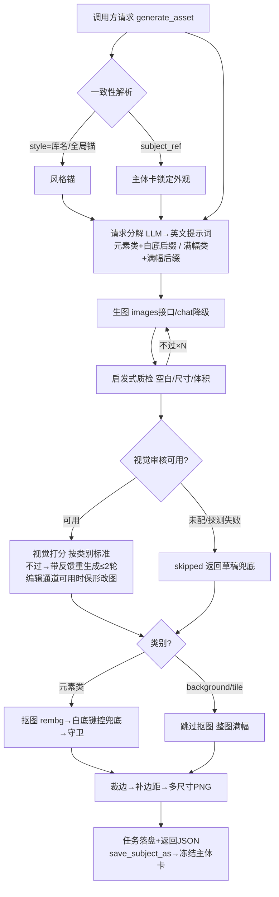

# AI 游戏素材生成器（MCP server）

> 简要一句话:为 AI 客户端（ZCode 等）解决"一句话要一张可直接入引擎的游戏素材"的问题——MCP 工具一条龙完成分解→白底生图→审核→抠图→多尺寸透明 PNG。

## 1 · 业务诉求与边界

- 一句话：AI 调 `generate_asset("一把火焰剑")`，拿回 512/256/128 的透明底 PNG 绝对路径，直接可读、可入引擎。
- 输入触发：AI 客户端经 MCP 调用工具（用户对话中提出素材需求）。
- 输出交付：任务目录内 draft.png（元素类为白底草稿/满幅类为整图）、cutout.png（仅元素类）、master.png（裁边母版）、finals/*_N.png（各尺寸 PNG：元素类透明底，background/tile 满幅）+ task.json 元数据；结果 JSON 返回给调用方。
- 不做：批量素材表/多素材混合打包、3D 素材、主体卡自动从已有图片反推（需视觉模型，属未来增强）、帧间像素级插值（现动画为独立帧序列，非插值动画）。
- 成功标准（质量/时延/成本/可接受度）：
  - 质量：元素类终稿为透明背景、主体完整未被裁切、边缘无明显白晕；同一主体卡两次生成外观一致（红披风女骑士实测通过）；单任务默认 1 次生图调用（审核重生成为增量）。
  - 时延：单任务端到端 ≤ 3 分钟（含最多 2 轮审核重生成）。
  - 成本：默认尺寸 1024 生图 1 次；`sizes` 最多 6 档防滥用。
  - 可接受度：视觉审核不可用时明确标记 `skipped` 并返回草稿路径，交调用方 AI 终判，不静默降质。

## 2 · 输入与触发

- 触发源：MCP 客户端工具调用（stdio）。
- 输入数据结构：`generate_asset(description, category, style, sizes, feedback, subject_ref, save_subject_as, save_style_as)`；`cutout_image(image_path, sizes, padding_ratio)`；`list_assets(prefix)`；`list_library()`。
- 格式约束：category ∈ character/item/icon/tile/effect/ui/background（非法值降级 item 并记 note）；sizes 为 16–2048 px 正方形边长列表，去重降序，默认 [512,256,128]。
- 类别分两族：**元素类**（character/item/icon/effect/ui）强制白底生成、抠图输出透明底；**满幅类**（background/tile）整图铺满画幅、不抠图。

## 3 · 输出与交付

- 输出形态：RGBA PNG（透明底）多尺寸 + 白底草稿 + 元数据 JSON；路径均为绝对路径，调用方 AI 可直接 Read 查看。
- 交付对象：调用方 AI（及最终用户）。
- 对下游影响：finals 可直接作为游戏引擎素材；draft_path 供 AI 复核后决定是否带 `feedback` 重生成。

## 4 · 流程图

见本目录 `流程图.mmd`，渲染后贴回此处：



## 5 · 节点定义表

| 节点 | 类型 | 输入 | 输出 | 模型/工具 | 自研/复用 |
|---|---|---|---|---|---|
| 一致性解析 | 本地计算 | style 参数/subject_ref | 风格锚+主体卡约束 | lib/ 主体卡与风格库 | 自研 |
| 请求分解 | LLM 调用 | 中文/口语描述+类别+风格+卡/锚 | 结构化英文提示词 JSON | grok-chat-fast | 自研（提示词工程） |
| 生图 | 生图 API | 英文提示词+尺寸（元素类含白底后缀） | PNG 二进制 | grok-imagine-image-quality-lite（OpenAI 兼容代理） | 复用 01_漫画生成 ImageClient 双通道模式 |
| 启发式质检 | 本地计算 | 图片文件 | 通过/原因 | Pillow（方差/尺寸/体积） | 自研（抄 01 critic 思路） |
| 视觉审核 | 视觉 LLM | 草稿图+主题+类别 | {pass,score,issues} | `ASSET_VISION_MODEL`（可挂独立服务商；当前未配，自动降级） | 自研（探测+降级） |
| 抠图 | 本地推理 | 白底 PNG | RGBA | rembg(u2net/onnxruntime)；兜底 PIL 白底键控；满幅类别跳过 | 复用 rembg + 自研兜底 |
| 缩放输出 | 本地计算 | RGBA | 多尺寸 PNG | Pillow LANCZOS | 自研 |
| 卡/风格冻结 | 本地计算 | 当次生效描述 | lib/ JSON 卡片 | — | 自研 |
| 编排/落盘 | 代码 | — | 任务目录+task.json | — | 自研 |

## 6 · 模型与调用点

| 调用点 | 模型厂家/型号 | 温度 | Token 上限 | 备注 |
|---|---|---|---|---|
| 请求分解 | 代理 grok-chat-fast | 0.3（失败降温 0.0 重试） | 400 | 强制 JSON 输出；注入风格锚/主体卡 |
| 生图 | 代理 grok-imagine-image-quality-lite | — | — | images/generations 主通道，chat 降级通道 |
| 图生图编辑 | `ASSET_EDIT_MODEL`（StepFun 官方 step-image-edit-2，/images/edits multipart） | — | — | 动画锚帧条件生成（第 0 帧文生图定锚，后续帧"同角色仅改姿势"）+ generate_asset 带反馈重生成的保形改图；key 留空不启用，失败自动回退文生图 |
| 视觉审核 | claude-haiku-4-5 @ newapi.dragon3api.com（独立服务商，非推理型秒级） | 0.0 | 1500 | 备用 step-3.7-flash @ yujianwudi.top（推理型，单轮 30–45s，配置注释保留在 .env）；`uv run python check_vision.py` 一键验证 |

## 7 · 工具与集成

| 工具名 | 形态(MCP / API / SDK) | 提供能力 | 自研/第三方 | 备注 |
|---|---|---|---|---|
| generate_asset | MCP (stdio) | 分解→生图→审核→抠图(满幅跳过)→多尺寸；subject_ref/save_subject_as/save_style_as 一致性参数 | 自研 | 主工具 |
| generate_animation | MCP (stdio) | 第0帧文生图定锚+后续帧图生图编辑→审核→归一化→spritesheet+GIF | 自研 | walk/walk_side/idle/attack 动作 |
| cutout_image | MCP (stdio) | 任意图片抠图+多尺寸 | 自研 | 后处理独立入口 |
| list_assets | MCP (stdio) | 历史任务汇总 | 自研 | 读 task.json |
| list_library | MCP (stdio) | 主体卡/风格库查看 | 自研 | 跨任务一致性入口 |
| rembg | Python 库 | AI 语义抠图 | 第三方(MIT) | 可选依赖，缺失自动白底键控 |
| 生图代理 | HTTP API | OpenAI 兼容 chat+images | 第三方 | 与 01_漫画生成 共用端点 |
| 图生图编辑 | HTTP API | StepFun 官方 /images/edits（step-image-edit-2） | 第三方(官方 API) | .env 的 ASSET_EDIT_* 三件套，独立于生图代理 |
| 视觉服务 | HTTP API | OpenAI 兼容视觉模型 step-3.7-flash | 第三方(new-api 渠道) | .env 的 ASSET_VISION_* 三件套,独立于生图代理 |

## 8 · 异常与降级

| 异常情形 | 检测方式 | 降级动作 | 是否需要人工兜底 |
|---|---|---|---|
| LLM 分解输出坏 JSON | 容错解析（剥围栏+括号平衡）失败 | 直译描述+本地模板合成，标记 fallback | 否 |
| images/generations 不可用 | HTTP ≥400 | chat 降级通道提取图片 URL | 否 |
| 生成空白/坏图 | 启发式质检（方差<6 等） | 删图重试 ≤2 次，耗尽返回结构化错误 | 可带 feedback 重调 |
| 视觉模型缺失/看不了图 | 启动探测（1x1 测试图）失败 | review=skipped，返回 draft 由调用方 AI 终判 | 调用方 AI 看图 |
| 视觉审核不过 | score<8 | 带反馈重生成 ≤2 轮；仍不过则照常交付并标记 failed | 调用方 AI 决定 |
| 主体卡不存在 | lib/subjects 查无 | 忽略卡继续生成，notes 标记 | 否 |
| 满幅类别误请求抠图 | 类别∈background/tile | 生图走满幅后缀、跳过抠图，cutout.method=skipped | 否 |
| MCP 子进程 https 校验失败 | Windows 注册表残留系统代理被 httpx 自动挂载 | 客户端 trust_env=False 永远直连（.env 可配 ASSET_HTTP_PROXY 显式走代理）；详见 用例集 L15 | 否 |
| 推理型视觉模型正文无 JSON | 解析失败 | 加倍 max_tokens 重试一次；再失败按 status=error 处理不阻断 | 否 |
| 视觉探测瞬时抖动 | 探测调用失败 | 立即重试一次，防单次抖动缓存成"永久不可用" | 否 |
| rembg 未装/推理崩 | import 失败 / 异常捕获 | 白底键控兜底（边缘泛洪，保内部白） | 否 |
| 图生图编辑通道失败 | key 未配 / HTTP 错误 / 质检耗尽 | 动画该帧起回退逐帧文生图（sticky）；generate_asset 回退"重新分解+全新生成"；notes 记录 | 否 |
| 主体本身近白被误删 | 不透明占比 <8% 守卫 | 保留原图不透明，notes 标注 | 是（换背景描述重生成） |
| 任意工具异常 | try/except | 返回 {status:"error",message} 不抛裸异常 | 视信息重试 |

## 9 · 人工介入触发点

- 触发节点：视觉审核 skipped/failed 时，调用方 AI 查看 draft_path 自行终判；不满意带 `feedback` 参数重调。
- 审批人 / SLA：调用方 AI（或用户）即时。
- 介入后的数据回流：feedback 进入下一轮请求分解提示词。

## 10 · 安全与合规

- 数据脱敏：—（输入为素材描述，不含 PII）。
- PII 处理：不收集。
- 日志留存策略：任务目录内 task.json（含提示词与结果路径）；API key 只存 `.env`，不进文档/日志。
- 所用项目的许可证影响：rembg 为 MIT；mcp SDK 为 MIT；均允许商用。

## 11 · 可观测性与评估

- trace 埋点：每任务 task.json 记录 prompt/image_calls/review rounds/elapsed_s/notes。
- 关键指标（质量/延迟/成本）：elapsed_s（目标 <180s）、image_calls（目标 =1）、审核通过率、抠图方法分布（rembg vs 兜底 vs 守卫）。
- 回归用例集：见 `用例集.md`（离线 pytest 全覆盖 + live 冒烟记录）。

## 12 · 部署形态

- 自托管 / 云：本地（Windows）stdio 进程，由 MCP 客户端（ZCode 等）按 `mcp_config.example.json` 拉起。
- 容器拓扑：—（单进程）。
- 依赖项：Python ≥3.11、uv；可选 `--extra rembg`（onnxruntime，模型 ~170MB 存 `~/.u2net`）。
- 最低资源：能跑 Python + Pillow 即可（rembg 可选，CPU 推理约需 1–2GB 内存）。

## 13 · 成本与限流

- 单次 Token 预算：分解 ≤400 token、审核 ≤300 token/轮。
- 并发上限：单客户端串行（stdio 每工具调用顺序执行）。
- 速率限制：依赖上游代理限制；单任务默认 1 次生图（重试/审核重生成为增量，上限 1+2+2 次）。
- 月度预算：由上游代理账单控制。

## 14 · 选型依据

- 主力项目 + 一句话理由：**mcp 官方 Python SDK（MCPServer/FastMCP 风格高层 API）**——MCP 客户端生态兼容性最好，`@tool` 装饰器即得 schema，与 workflow_template 的 MCP client 侧（`mcp__{server}__{tool}` 前缀路由）天然对接。
- 备选项目：Node `@modelcontextprotocol/sdk`（团队若统一 JS 栈可平移）；直接复用 workflow_template AgentEngine（本工作流定位是"被调用的工具服务"而非"发起调用的引擎"，故不套）。
- 复用 vs 自研划分：
  - 复用：01_漫画生成 的 ImageClient 双通道生图、容错 JSON 解析、启发式质检思路、.env+config.yaml 双层配置、MockTransport 离线测试基线；rembg 语义抠图；mcp SDK。
  - 自研：MCP 工具层（4 工具）、请求分解提示词工程与类别模板（元素白底/满幅双后缀）、一致性层（全局风格锚+风格库+主体卡库）、视觉审核探测+降级+独立端点接入、白底键控兜底算法（边缘泛洪+近白守卫+羽化）、多尺寸缩放输出、任务目录/task.json、list_assets/list_library 汇总。

## 附 · 快速开始

```bash
cd 实现
uv sync --extra dev --extra rembg      # rembg 可选,不装自动白底键控兜底
cp .env.example .env                   # 填 base_url / api_key / 模型名
uv run pytest -q                       # 离线测试,零 API 消耗
uv run python -m app.server            # 启动 MCP server(stdio)
uv run python check_vision.py          # (配好 ASSET_VISION_* 后)一键验证视觉模型
uv run python check_edit.py            # (配好 ASSET_EDIT_API_KEY 后)一键验证图生图编辑
# 注册到 ZCode/Claude 等客户端:参见 mcp_config.example.json
```

## 附 · 视觉模型接入步骤（已按此接入 step-3.7-flash，2026-08-16）

1. `.env` 填三件套：`ASSET_VISION_MODEL=<模型名>`；若挂在别的服务商再加 `ASSET_VISION_BASE_URL` / `ASSET_VISION_API_KEY`（OpenAI 兼容即可，留空则用主端点）。
2. `uv run python check_vision.py [某张draft.png]` 一键验证（能力探测 + 真实图试审）。
3. 之后所有 `generate_asset` 自动走视觉审核循环（不过自动带反馈重生成 ≤2 轮），结果里 `review.status=ok/failed`。
4. 注意：若换用**推理型**视觉模型（如 step 系列，回复先出 reasoning_content），审核调用已预留 1500 max_tokens 余量；若仍出现正文为空，继续调大 reviewer.py 里的 max_tokens。

## 附 · 图生图编辑通道接入步骤（④帧间条件生成，2026-08-16）

> 背景：文生图逐帧独立生成是动画高成本根因（walk_side 曾 19 次生图/6 帧）。接入指令式图生图后，动画第 0 帧文生图定锚、后续帧编辑锚帧"同角色仅改姿势"，外观由参考图条件化，漂移在生成阶段被压住。

1. `.env` 填：`ASSET_EDIT_API_KEY=<StepFun key>`（默认 `ASSET_EDIT_BASE_URL=https://api.stepfun.com/v1`、`ASSET_EDIT_MODEL=step-image-edit-2`，可按需覆盖）。
2. `uv run python check_edit.py` 一键验证（红圈→蓝圈改色冒烟 + 中心像素校验）；也可 `check_edit.py 某张draft.png "中文改图指令"` 试编真实图。
3. 之后 `generate_animation` 自动走锚帧条件生成（结果 `edit=true`），`generate_asset` 审核不过时的重生成也升级为"编辑当前草稿"保形改图。
4. key 留空或通道失败：自动回退原逐帧文生图 / 全新生成路径，行为与未接入时一致，notes 会记录回退原因。

**live 已验证**（2026-08-16）：冒烟（红圈改蓝）与真实图保形改图（红披风→蓝披风）通过；walk_side 对照实验 **19→11 次生图调用（-42%）、目检 7.5→8.5 分、466s→186s**，数据与错配修正记录见 用例集 第八节。

**为何直连 StepFun 官方**（2026-08-16 探测结论，详见 用例集 第八节）：主代理 `:3000`（grok2api）的 `/images/edits` 只支持 grok 系模型且其 grok 模型未挂 edit 能力（模型不存在）；step 模型走 chat 只能"看图"不能"出图"（返回的 imgur 链接为幻觉）；备用服务商均无可用编辑端点。StepFun 官方 `step-image-edit-2` 是当前可用的指令式编辑模型（multipart `/v1/images/edits`，输出跟随输入尺寸，采样参数 cfg_scale=1.0/steps=8 沿用官方示例）。
