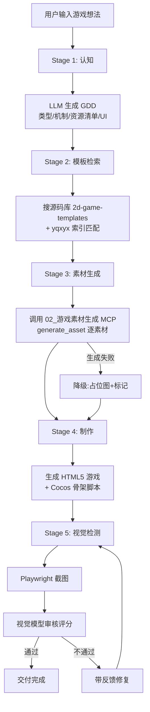

# 03_游戏制作（AI Game Production Workflow）

> 简要一句话:为 **AI 助手** 解决"从一句话游戏想法到可玩原型"的问题——认知→选模板→生素材→制代码→视觉检测，五阶段闭环。

## 1 · 业务诉求与边界

- **一句话**：输入「我想做一个 X 类型的游戏，主题是 Y」，输出一个**可运行的 HTML5 游戏原型** + **Cocos Creator 3.x 项目骨架** + **素材资源清单**。
- **输入触发**：用户对话中提出游戏想法（一句话描述）。
- **输出交付**：
  - 游戏设计文档（GDD JSON）
  - 匹配的源码模板路径
  - 生成的素材 PNG 目录
  - 可运行 HTML5 原型（Canvas 2D）
  - Cocos Creator 移植指南
  - 视觉检测报告（每阶段截图+评分）
- **不做**：3D 游戏、网络多人、后端服务、抖音小游戏打包（工作流只出到 Cocos 骨架，打包由用户手动完成）、音效生成（预留扩展点）。
- **成功标准**：
  - 质量：产出可运行的 HTML5 原型，核心玩法完整
  - 时延：单次全流程 ≤ 10 分钟（其中素材生成占大头）
  - 成本：素材生成按 02_游戏素材生成 标准控制
  - 可接受度：每个阶段产出可独立查看/修改，支持 resume

## 2 · 输入与触发

- **触发源**：用户对话 / CLI 命令 `uv run python -m app.main "游戏描述"`
- **输入数据结构**：
  ```json
  {
    "idea": "我想做一个塔防游戏，中世纪风格，5种敌人4种塔",
    "game_type": "towerdefense",  // 可选，不填自动推导
    "style": "medieval cartoon",
    "output_dir": "./out/my-td-game"
  }
  ```
- **格式约束**：`game_type` 为模板库中存在的类型（从索引自动匹配）。

## 3 · 输出与交付

- **输出形态**：
  - `output_dir/` 目录
    - `design.json` — 游戏设计文档
    - `template_match.json` — 模板匹配结果
    - `assets/` — 素材 PNG（各尺寸）
    - `game/` — HTML5 原型（`index.html` + `game.js` + 资源）
    - `cocos/` — Cocos Creator 移植指南 + 脚本
    - `qa/` — 视觉检测报告（截图+评分）
    - `checkpoint.json` — 工作流状态（支持 resume）
- **交付对象**：AI 助手（及最终用户）。
- **对下游影响**：HTML5 原型可直接浏览器打开试玩；Cocos 骨架可直接导入 Cocos Creator 3.x。

## 4 · 流程图

见 `流程图.mmd`，渲染后贴回此处：



## 5 · 节点定义表

| 节点 | 类型 | 输入 | 输出 | 模型/工具 | 自研/复用 |
|------|------|------|------|-----------|---------|
| 认知 (Cognition) | LLM 调用 | 用户想法文字 | 结构化 GDD JSON | DS V4 Flash (newapi #26) | 自研（提示词工程） |
| 模板检索 (Template Search) | 本地搜索 | GDD 类型/关键词 | 匹配的模板路径+索引 | rg 搜索 + DS V4 匹配 | 自研 |
| 素材生成 (Asset Generation) | 工具调用 | 资源清单（描述+类别+风格） | 透明 PNG 多尺寸 | 02_游戏素材生成 gen_asset.py | 复用 02 工作流 |
| 制作 (Build) | LLM 调用 + 代码生成 | GDD + 模板 + 素材路径 | HTML5 游戏文件 | Opus 5 (newapi #31) | 自研（代码生成提示词） |
| 视觉检测 (Vision QA) | 视觉 LLM | 游戏截图 | 审核报告（评分+问题列表） | Step 8000M (stepfun #29) | 自研 |

## 6 · 模型与调用点

| 调用点 | 模型厂家/型号 | 温度 | Token 上限 | 备注 |
|--------|-------------|------|-----------|------|
| 认知阶段 | DS V4 Flash @ newapi:3000 | 0.5 | 4096 | 便宜够用 |
| 模板匹配 | DS V4 Flash @ newapi:3000 | 0.3 | 2048 | 分类匹配 |
| 素材生成 | gen_asset.py（内部 Grok 生图） | — | — | 复用 02 工作流 |
| 代码生成 | Opus 5 @ bb-api:3000 | 0.2 | 8192 | 编程最佳 |
| 视觉检测 | Step 8000M @ stepfun:3000 | 0.0 | 2048 | 视觉审核 |

## 7 · 工具与集成

| 工具名 | 形态 | 提供能力 | 自研/第三方 | 备注 |
|--------|------|---------|-----------|------|
| gen_asset.py | CLI | 素材生成（文字→透明 PNG） | 自研（02 工作流） | `uv run python gen_asset.py ...` |
| Playwright | Python 库 | 无头浏览器截图 | 第三方 | 用于视觉检测截屏 |
| 2d-game-templates | 本地目录 | 游戏模板索引+提取逻辑 | 自研 | `D:\core\2d-game-templates\` |
| newapi | HTTP API | LLM 模型统一路由 | 第三方 | localhost:3000 |

## 8 · 异常与降级

| 异常情形 | 检测方式 | 降级动作 | 是否需要人工兜底 |
|---------|---------|---------|----------------|
| LLM 生成坏 JSON | 解析失败(JSONDecodeError) | 降级为默认模板 GDD | 否 |
| 模板库未匹配 | 搜索结果为空 | 使用通用 HTML5 游戏骨架+纯逻辑 | 否 |
| 素材生成失败（gen_asset 报错） | 非零退出码 | 生成占位色块 PNG + notes 标记 | 调用方 AI 决定 |
| 代码生成输出格式错误 | 语法检查/缺失文件 | 重试一次，仍失败则输出结构化错误 | 是 |
| Playwright 不可用 | import 失败 | 跳过视觉检测，只输出游戏 | 用户手动测试 |
| 视觉模型不可用 | HTTP 4xx/5xx | 跳过检测，标记 skipped | 用户手动检查 |

## 9 · 人工介入触发点

- **触发节点**：视觉检测 failed（< 7 分）时，输出截图+问题描述，调用方 AI 判断是否接受
- **审批人 / SLA**：调用方 AI 即时
- **介入后的数据回流**：人工反馈进入下一轮代码修复

## 10 · 安全与合规

- **数据脱敏**：不收集用户数据
- **PII 处理**：输入为游戏想法，不含 PII
- **日志留存策略**：`output_dir/checkpoint.json` 记录每阶段产物
- **所用项目的许可证影响**：本工作流产物为原创代码，不包含版权素材

## 11 · 可观测性与评估

- **trace 埋点**：checkpoint.json 记录每阶段状态、时间戳、产物路径
- **关键指标**：stage_elapsed_s、素材生成次数、视觉检测评分
- **回归用例集**：见 `用例集.md`

## 12 · 部署形态

- **自托管 / 云**：本地 CLI，Python ≥3.11 + uv
- **容器拓扑**：单进程
- **依赖项**：httpx, Pillow; 可选 playwright (视觉检测)
- **最低资源**：能跑 Python + 调用 LLM API 即可

## 13 · 成本与限流

- **单次 Token 预算**：认知 2K + 模板匹配 1K + 代码生成 8K + 视觉检测 2K = ~13K tokens/次
- **并发上限**：串行（单进程）
- **速率限制**：跟随上游 API 限制
- **月度预算**：由上游 API 账单控制

## 14 · 选型依据

- **主力项目 + 一句话理由**：**自研轻量 Pipeline**——5 阶段线性流水线，每阶段独立可 debug，checkpoint 可 resume，无重型框架依赖
- **备选项目**：**LangGraph**（有状态图编排，适合复杂分支场景）；**workflow_template**（Agent 循环，适合需要多轮交互的场景）
- **复用 vs 自研划分**：
  - 复用：02_游戏素材生成（gen_asset.py）、2d-game-templates（模板库）、newapi（模型路由）
  - 自研：Pipeline 编排器、GDD 生成提示词、模板匹配逻辑、代码生成提示词、视觉检测脚本