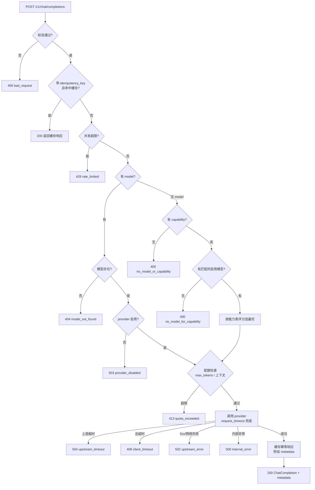

# model_gateway(轻量 LLM 网关)

> 简要一句话:为 **接入多个 LLM 厂商的业务方** 解决 **"多模型接入、选型和错误处理各自为政"** 的问题——对外一个 OpenAI 兼容接口,内部按显式 `model` 或 `capability` 意图自动分发。

## 1 · 业务诉求与边界
- 一句话:把"多个 OpenAI 兼容厂商 + 多种选型意图 + 各类错误"收敛成一个稳定接口。
- 输入触发:业务方发起 `POST /v1/chat/completions`(OpenAI 兼容协议)。
- 输出交付:标准 ChatCompletion 响应 + `metadata`(实际路由结果/耗时/追踪 ID);错误统一错误体与状态码。
- 不做:流式响应、鉴权计费、多副本部署的分布式限流与幂等(见 README 已知限制与接口文档 §8)。
- 成功标准(质量/时延/成本/可接受度):
  - 显式与智能路由正确命中目标模型(metadata 可验证)
  - 全部错误路径有稳定状态码与错误码,25 个测试全绿
  - Mock 模式零网络、零成本、可重复;真实模式仅需配 `.env` 即切换

## 2 · 输入与触发
- 触发源:HTTP 客户端(业务后端 / 脚本 / Swagger UI)。
- 输入数据结构:`messages`(必填)+ `model` / `capability`(二选一)+ `max_tokens` / `temperature` / `stream` + 扩展字段 `request_id` / `idempotency_key`。
- 格式约束:JSON;`capability` 取值 `low_cost / low_latency / high_quality / long_context / vision`;字段级校验由 Pydantic 完成(失败 → 400)。

## 3 · 输出与交付
- 输出形态:OpenAI 兼容 ChatCompletion JSON + 网关扩展 `metadata` 字段。
- 交付对象:调用方业务系统;错误时返回统一错误体 `{"error": {message, type, code}}`。
- 对下游影响:业务方只依赖单一协议,更换/增删厂商模型不改业务代码;`request_id` 贯穿调用链便于排障。

## 4 · 流程图
见本目录 `流程图.mmd`,渲染后贴回此处:



## 5 · 节点定义表
| 节点 | 类型 | 输入 | 输出 | 模型/工具 | 自研/复用 |
|---|---|---|---|---|---|
| 请求校验 | 处理 | 请求 JSON | ChatRequest 对象 / 400 | FastAPI + Pydantic | 复用(框架) |
| 幂等检查 | 处理 | idempotency_key | 缓存响应 / miss | IdempotencyCache(内存 TTL) | 自研 |
| 并发限流 | 处理 | 在途计数 | 放行 / 429 | ConcurrencyLimiter(内存计数) | 自研 |
| 路由决策 | 处理 | model / capability | ModelConfig | capabilities.py 评分表 | 自研 |
| 配额检查 | 处理 | messages + max_tokens | 放行 / 413 | tokens 估算 | 自研 |
| Provider 调用 | 处理 | ModelConfig + messages | ProviderResult / 异常 | httpx AsyncClient(OpenAI 兼容) | 自研(协议复用 OpenAI 标准) |
| 响应组装 | 输出 | ProviderResult | ChatCompletion + metadata | Pydantic 模型 | 自研 |

## 6 · 模型与调用点
| 调用点 | 模型厂家/型号 | 温度 | Token 上限 | 备注 |
|---|---|---|---|---|
| 主聊天(显式) | OpenAI `gpt-4o` / `gpt-4o-mini`、DeepSeek `deepseek-chat`、Qwen `qwen-max` / `qwen-turbo`、Moonshot `moonshot-v1-32k` | 调用方指定,透传 | 见 config.yaml(128k/64k/32k 等) | 全部走 OpenAI 兼容协议,一套 adapter |
| 主聊天(智能) | 同上 + Mock 模型族 | 同上 | 同上 | capability 评分自动选型 |
| 测试/演示 | `mock-fast` / `mock-smart` / `mock-vision` / `mock-fail-*` / `mock-counted` 等 | — | 行为可配 | behavior 驱动,稳定复现错误 |

## 7 · 工具与集成
| 工具名 | 形态(MCP / API / SDK) | 提供能力 | 自研/第三方 | 备注 |
|---|---|---|---|---|
| OpenAI 兼容 adapter | SDK(httpx) | 直连各厂商 `/chat/completions` | 自研(基于开放协议) | 支持按 provider 配代理(`OPENAI_PROXY`) |
| Mock adapter | SDK(进程内) | 行为可配的本地模型 | 自研 | `behavior: ok/timeout/overflow/http_502/network/counted` |

## 8 · 异常与降级
| 异常情形 | 检测方式 | 降级动作 | 是否需要人工兜底 |
|---|---|---|---|
| 请求体不合法 | Pydantic 校验 | 400 bad_request | 否 |
| model 不存在 | 模型表查不到 | 404 model_not_found | 否 |
| capability 无匹配 | 候选集为空 | 400 no_model_for_capability | 否 |
| provider 未启用 | 无 api key / 模式不符 | 503 provider_disabled | 是(运维配 key 或切模式) |
| 超配额(输出/上下文) | 网关侧估算拦截;上游报溢出 | 413 quota_exceeded | 否(调用方换模型或减 token) |
| 上游超时 | provider 报告 | 504 upstream_timeout | 否(调用方重试/换 low_latency 模型) |
| 客户端总超时 | asyncio.wait_for 兜底 | 408 client_timeout | 否 |
| 上游 5xx / 网络失败 | HTTP 状态码 / httpx 异常 | 502 upstream_error | 否(暂无自动 fallback,列入演进) |
| 重复提交 | idempotency_key + TTL 缓存 | 200 重放上次响应 | 否 |
| 并发风暴 | 在途计数超限 | 429 rate_limited | 否 |
| 内部异常 | 全局异常 handler | 500 internal_error(限流计数必释放) | 是(需排查日志) |

## 9 · 人工介入触发点
- 触发节点:provider 启用状态(503)与内部异常(500)。
- 审批人 / SLA:运维 / 值班开发,当班内处理。
- 介入后的数据回流:补配 `.env` 的 key 或修复后,`/health` 状态翻转即恢复,无需改代码。

## 10 · 安全与合规
- 数据脱敏:网关不落盘请求内容;日志仅记 request_id、路由结果与状态码。
- PII 处理:请求直传上游,网关不做存储;真实模式下数据出境合规由所选厂商协议约束。
- 日志留存策略:当前仅 uvicorn 标准输出,按部署环境外接收集。
- 所用项目的许可证影响:核心依赖 FastAPI/MIT、Pydantic/MIT、httpx/BSD、uvicorn/BSD、PyYAML/MIT——均为宽松许可,商用无附加义务。

## 11 · 可观测性与评估
- trace 埋点:`request_id`(可由调用方传入)贯穿请求;`metadata.latency_ms` 记录上游耗时。
- 关键指标(质量/延迟/成本):路由命中率(metadata.routed_model 分布)、latency_ms、usage tokens、4xx/5xx 错误码分布。
- 回归用例集:见 `用例集.md`;对应自动化 `uv run pytest -v`(25 用例全绿)。

## 12 · 部署形态
- 自托管 / 云:自托管,单进程 FastAPI 服务。
- 容器拓扑:单副本(`uvicorn app.main:app`);幂等/限流为进程内存态,多副本需外置 Redis(演进项)。
- 依赖项:Python ≥ 3.11;fastapi、uvicorn、httpx、pydantic、pydantic-settings、pyyaml(uv 管理,见 `pyproject.toml`)。
- 最低资源:单核 / 256MB 级即可(真实模式的吞吐瓶颈在上游与网络)。

## 13 · 成本与限流
- 单次 Token 预算:由所选模型 `max_output` 与 `max_context` 双重硬限(413 拦截)。
- 并发上限:`max_concurrency = 8`(默认,`GW_MAX_CONCURRENCY` 可覆盖)→ 超限 429。
- 速率限制:当前仅并发维度;QPS/RPM 维度列入演进。
- 月度预算:未内建;`usage` 字段已透出,可外接计费统计。

## 14 · 选型依据
- 主力项目 + 一句话理由:**自研轻量网关**——范围有限(主聊天 + 混合路由 + 错误注入),且需要在测试中精确触发各类错误(mock 行为模型),自研骨架最可控,也是本工作空间首次落地。
- 备选项目:**LiteLLM**(MIT,~28k stars,已补入《开源项目索引》D 类)——统一 OpenAI 协议代理 100+ 厂商,配额/限流/降级/fallback 开箱即用。
- 复用 vs 自研划分:
  - 复用(用所选项目现成能力):Web 框架/校验/文档(FastAPI + Pydantic)、OpenAI 兼容协议本身、httpx 异步客户端;不重造协议与框架。
  - 自研(必须自己写):路由决策(显式 + capability 评分)、能力表、幂等 TTL 缓存、并发限流、mock 行为模型、错误族 → HTTP 映射。
  - 切换判据:扩到全协议(非 chat 端点)、多 provider 负载均衡、配额管理、分布式部署时,评估整体切换 LiteLLM Proxy,业务侧因协议不变而无感。

## 附 · 快速开始

```bash
cd model_gateway
uv sync --extra dev                    # 安装依赖
uv run uvicorn app.main:app --reload   # 起服务(MOCK 模式,零配置)
# 浏览器打开 http://127.0.0.1:8000/docs 可搜索、试调
uv run pytest -v                       # 25 个用例全绿
```

切真实模式:`cp .env.example .env` 填 key,设 `GW_MODE=real`,重启即可。完整字段/错误码/模型清单见工作空间根的《接口文档.md》。
