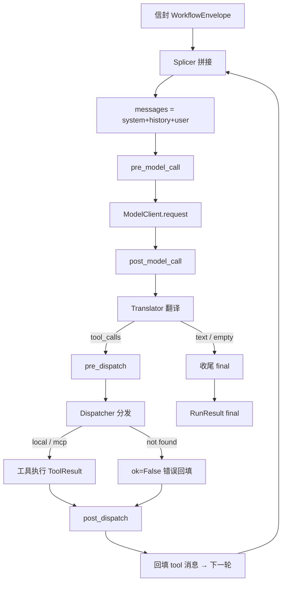

# workflow_template(AI 工作流模板)

> 简要一句话:为 **需要编排 AI Agent 工具调用循环的业务方** 提供 **一套可复用的 JSON 消息协议 + 翻译器/分发器骨架**,对接本地工具与 MCP 服务。

## 1 · 业务诉求与边界
- 一句话:把"多轮对话→模型回复→解析→分发工具→结果回填→再推理"的标准 Agent 循环收敛成可复用模板。
- 输入触发:业务方构造 WorkflowEnvelope(JSON 信封)并调用引擎 run()。
- 输出交付:RunResult(status/final_text/steps/transcript),含每轮留痕。
- 不做:流式响应、持久化对话、分布式部署、鉴权、重型有状态图编排(如条件分支/人工审批/并行子图——这些场景应切到 LangGraph)。
- 成功标准:108 个测试全绿;离线 demo 完整多轮循环跑通;协议文档可 Ctrl+F 全文搜索。

## 2 · 输入与触发
- 触发源:Python 代码调用 `engine.run(envelope)`。
- 输入数据结构:WorkflowEnvelope(Pydantic,extra=allow);见 `协议.md` §1 和 `templates/workflow_request.json`。
- 格式约束:messages 遵循 OpenAI 兼容格式;tools 为 OpenAI function 定义;`context.vars` 为 `str→Any` 映射供 `{{var}}` 插值。

## 3 · 输出与交付
- 输出形态:RunResult 对象(status/final_text/error/steps/transcript);transcript 为完整 Message 列表。
- 交付对象:调用方业务代码。
- 对下游影响:业务方只需构造信封、注册工具,不感知循环细节;transcript 可用于对话上下文传递。

## 4 · 流程图
见 `流程图.mmd`,渲染后贴回此处:



## 5 · 节点定义表
| 节点 | 类型 | 输入 | 输出 | 模型/工具 | 自研/复用 |
|---|---|---|---|---|---|
| Splicer 拼接 | 处理 | envelope.inputs + context | messages[] | — | 自研 |
| ModelClient 请求 | 处理 | ModelRequest + tools[] | 模型回复 JSON | model_gateway / 任意 OpenAI 兼容端点 | 自研(协议复用 OpenAI 标准) |
| Translator 翻译 | 处理 | 模型回复 JSON + registry | TranslatedReply | — | 自研 |
| Dispatcher 分发 | 处理 | TranslatedToolCall[] + registry | ToolResult[] | 本地 @tool / MCP 服务 | 自研(MCP 复用官方 SDK) |
| Hook 钩子 | 观察 | 各节点 payload | 无(仅回调) | — | 自研 |

## 6 · 模型与调用点
| 调用点 | 模型厂家/型号 | 温度 | Token 上限 | 备注 |
|---|---|---|---|---|
| 主聊天(Agent 循环) | 通过 model_gateway 间接:OpenAI/DeepSeek/Qwen/Moonshot | 信封 request.temperature | 信封 request.max_tokens | 协议不锁定具体模型,由信封 request.model/capability 决定 |
| 离线测试/演示 | ScriptedModelClient(脚本序列) | — | — | 零网络,稳定可复现 |

## 7 · 工具与集成
| 工具名 | 形态 | 提供能力 | 自研/第三方 | 备注 |
|---|---|---|---|---|
| 本地 @tool | Python 装饰器 | 同进程内函数,签名自动生成定义 | 自研 | @tool(fn) 注册 |
| terminal 终端调用 | 内置 @tool | 系统默认 shell 执行命令行(管道/重定向/&&) | 自研 | app/builtin_tools.py |
| run_command 命令工具 | 内置 @tool | 直接启动程序+参数列表,不经 shell 解析(更安全) | 自研 | 注入面最小 |
| powershell | 内置 @tool | PowerShell 执行(pwsh 优先回退 powershell) | 自研 | -NoProfile -NonInteractive |
| MCP 服务 | stdio(官方 SDK) | 外部进程工具,MCP inputSchema→OpenAI function | 第三方(官方 mcp SDK) | mcp_servers.json 配置化 |
| Mock MCP | Python Mock | 离线测试,handler 可自定义 | 自研 | transport=mock |
| model_gateway | HTTP(OpenAI 兼容) | 多模型路由与统一接入 | 本工作空间已有项目 | GatewayModelClient 可接任意 OpenAI 端点 |

## 8 · 异常与降级
| 异常情形 | 检测方式 | 降级动作 | 是否需要人工兜底 |
|---|---|---|---|
| 权限拒绝(未授权工具 / 命令超档) | PermissionPolicy 分发前审核 | ok=False 回填 "permission denied" 给模型自纠 | 否(或调策略授权) |
| 单条工具执行失败 | try/except in dispatch | ToolResult ok=False,错误文本回填给模型自纠 | 否 |
| 工具不存在 | registry.resolve ToolNotFound | ok=False 回填 | 否(配置或注册新工具) |
| 模型请求异常 | model.request 抛异常 | on_error 钩子 + RunResult status=error | 是(排查网关/网络) |
| 超过 max_steps | step 计数器 | status=max_steps(不静默截断) | 是(调大上限或检查工具设计) |
| MCP 服务未安装 | import 失败 | 明确 RuntimeError:请 `uv sync --extra mcp` | 是(安装 SDK 或用 Mock) |

## 9 · 人工介入触发点
- 触发节点:status=error(模型/网络异常)与 status=max_steps(循环不收敛)。
- 审批人 / SLA:开发运维,当班处理。
- 介入后:检查 RunResult.error/steps 留痕定位问题;修改信封或工具后重试。

## 10 · 安全与合规
- 数据脱敏:模板不落盘请求;钩子可注入日志/审计但默认不持久化。
- PII 处理:请求直传模型/工具,模板不做存储。
- 日志留存策略:钩子 on_start/on_error 可接入外部日志系统(扩展点 #3)。
- 所用项目的许可证影响:核心依赖 pydantic/MIT、httpx/BSD、mcp(Apache-2.0)——均为宽松许可。

## 11 · 可观测性与评估
- trace 埋点:7 个生命周期钩子(on_start → on_error),可用于日志/指标/审计。
- 关键指标:steps 轮数、tool_result.latency_ms、tool_result.ok 比例、transcript 长度。
- 回归用例集:见 `用例集.md`;对应自动化 `uv run pytest -v`(108 用例)。

## 12 · 部署形态
- 自托管 / 云:Python 包,嵌入业务进程;无独立服务形态。
- 容器拓扑:无;纯库。
- 依赖项:Python ≥ 3.11;pydantic + httpx(必须);mcp(可选,stdio 接入)。
- 最低资源:随宿主进程,无额外开销。

## 13 · 成本与限流
- 单次 Token 预算:由信封 request.max_tokens + 所选模型上限(由 model_gateway 管理)双重约束。
- 并发上限:由 model_gateway 管理;模板本身无内建限流。
- 速率限制:—
- 月度预算:—(透传给 model_gateway / 厂商计费)

## 14 · 选型依据
- 主力项目 + 一句话理由:**自研轻量模板**——价值在协议骨架(拼接/翻译/分发)与 8 个扩展点的标准化,体量小;作为本工作空间第二个落地的教学性/可控骨架。
- 备选项目:**LangGraph**(显式状态图+检查点+人工介入)、**Pydantic AI**(类型安全 Agent SDK)。当业务需要条件分支/并行子图/持久化检查点/人工审批节点等重型编排能力时,应切换到这些框架,本模板的信封协议可平滑迁移(消息已是 OpenAI 标准格式)。
- 复用 vs 自研划分:
  - 复用(用所选项目现成能力):OpenAI 兼容协议(messages/tool_calls)、MCP 官方 SDK(stdio 传输)、Pydantic 数据校验、httpx 异步客户端。
  - 自研(必须自己写):信封协议(拼接接口+扩展点)、翻译器(模型回复→结构化动作)、分发器(统一路由本地/MCP)、Agent 循环引擎、生命周期钩子、ScriptedModelClient(测试用)。
  - 切换判据:扩到有状态图/条件分支/并行/检查点/人工介入,切 LangGraph 或 Pydantic AI;模型接入层已由 model_gateway 覆盖,扩到全协议/负载均衡时切 LiteLLM。

## 附 · 快速开始

```bash
cd workflow_template/实现
uv sync --extra dev --extra mcp    # 安装依赖(mcp = 官方 SDK,长期记忆需要)
uv run pytest -v                   # 108 个用例全绿(离线)
uv run python -m app.main          # 离线 demo(3 轮循环,打印全过程)
uv run python -m app.main --memory # 长期记忆 demo(官方 MCP memory,跨会话记住事实)
# 接 model_gateway:
uv run python -m app.main --gateway http://127.0.0.1:8000 --model mock-smart
```

完整字段/错误码/扩展点见 `协议.md`;可复制 JSON 模板见 `templates/`。
`templates/mcp_servers.json` 内置 10 个真实开源 MCP 服务库(filesystem / fetch / memory / git / sequential-thinking / time / everything / playwright / context7 / brave-search),默认全部不启用,改 `enabled: true` + `registry.attach_mcp_config()` 即接入;启用 stdio 服务前需 `uv sync --extra mcp`。
