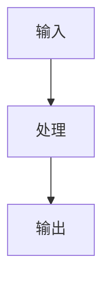

# AI 工作流设计指南

> 配套《开源项目索引》使用。这份文档规定在本工作空间「设计一个 AI 工作流」的**方法论、标准步骤、必填要素清单、产物格式**。每开始设计一个新工作流,直接复制文末「附录 A:工作流文档模板」为骨架,填完即得到该工作流的标准文档。

## 0. 什么时候按本指南走

在本工作空间开始设计**任何一个新 AI 工作流**时——不论用哪个开源项目落地、不论业务领域——都按本指南走一遍。

---

## 1. 设计 AI 工作流的标准步骤

### 第 1 步 · 业务诉求与边界
- 一句话讲清:**解决谁的什么问题**
- **输入触发**:用户输入 / 定时 / 系统事件 / 三者混合
- **输出交付**:回答 / 结构化数据 / 真实系统操作
- 明确**不做什么**(非目标同样要写进文档)
- **成功标准**:质量、时延、单次成本、上线后可接受度的最低门槛

### 第 2 步 · 把流程画出来
- 先用自然语言列步骤("谁做什么"),再转成节点图
- 节点类型:输入 → 处理(检索 / 推理 / 工具调用 / 人工)→ 输出
- 分支、循环、重试、人工介入点用虚线/特殊标记标出
- 推荐 Mermaid;源文件存到该工作流子目录的 `流程图.mmd`

### 第 3 步 · 对照《开源项目索引》选型
- 翻《开源项目索引.md》的「选型决策表」
- 先按主轴分类:
  - 偏「编排 Agent 推理」(记忆/规划/状态机)→ A 类(LangGraph / Pydantic AI / CrewAI / OpenAI Agents SDK 等)或 B 类可视化平台
  - 偏「把 AI 嵌业务流程」(跨系统、定时、审批)→ C 类(n8n / Activepieces)
  - 偏「RAG 知识库」→ RAGFlow / LlamaIndex / FastGPT
- 核对**许可证**:对外商用 SaaS 型用法,在 fair-code 项目(n8n/Dify/LobeChat/FastGPT)上必须先复审
- 按"团队形态"二次过滤:全开发者 → 代码框架;有非技术人员参与 → 可视化平台;已有 C#/Java 代码库 → Semantic Kernel
- **选 1 主力 + 1 备选**(便于将来换框架时有对照)
- 阶段业务未讲清时,**选型延后**

### 第 4 步 · 把关键决策落到表格
- 写清"为什么选主力项目、不选对照项目"几句
- 划出**复用 vs 自研**:哪些节点用所选项目现成能力,哪些必须自己写(业务查询、内部工具、私有协议)
- 这是将来评估是否换框架的依据,不能省

### 第 5 步 · 填写标准文档
复制「附录 A:工作流文档模板」为骨架,按「第 2 节·要素清单」逐项填齐。

### 第 6 步 · 评审与验证
- 列 5~10 个**评审用例**:覆盖主流路径 + 至少 2 个异常路径
- 标注每个用例的「预期输出 + 人工验收点」
- 设计完后回头核对第 1 步的「成功标准」是否被满足

---

## 2. 每个工作流必填的要素清单

| # | 要素 | 是否必填 | 说明 |
|---|---|---|---|
| 1 | 业务诉求与边界 | 必填 | 第 1 步产物 |
| 2 | 输入与触发 | 必填 | 触发源、输入数据结构、格式约束 |
| 3 | 输出与交付 | 必填 | 输出形态、交付对象、对下游影响 |
| 4 | 流程图 | 必填 | Mermaid 节点图,含异常与人工介入分支 |
| 5 | 节点定义表 | 必填 | 每个节点:type、输入、输出、所用模型/工具、是否自研 |
| 6 | 模型与调用点 | 必填 | LLM/Embedding/Rerank 的厂家、型号、温度、Token 上限 |
| 7 | 工具与集成 | 必填(若有) | 工具清单、MCP 服务、第三方 API、内部系统接入 |
| 8 | 异常与降级 | 必填 | 超时、失败回退、空结果、模型拒答的处理策略 |
| 9 | 人工介入触发点 | 可选 | 在哪些节点上挂人审批/接管(条件、谁审、SLA) |
| 10 | 安全与合规 | 必填 | 数据脱敏偏好、PII、日志留存、所用项目的许可证影响 |
| 11 | 可观测性与评估 | 必填 | trace/日志埋点、关键指标、回归用例集 |
| 12 | 部署形态 | 必填 | 自托管 / 云、容器拓扑、依赖项、最低资源 |
| 13 | 成本与限流 | 必填 | 单次 Token 预算、并发上限、速率限制、月度预算 |
| 14 | 选型依据 | 必填 | 主力项目 + 备选、复用 vs 自研划分、第 3/4 步产物 |

---

## 3. 命名与目录约定

每新建一个工作流,在本工作空间下建子目录 `工作流名/`,内含:

```
工作流名/
├── README.md        # 主文档,直接从「附录 A」模板复制
├── 流程图.mmd       # Mermaid 流程图源,渲染后可截图入文档
├── 用例集.md        # 评审用例 + 回归用例
├── 调研笔记.md      # 可选:对所选开源项目的深入拆解、二次开发路径
└── 实现/            # 可选:落地代码、配置、部署文件按需放置
```

- 子目录命名用 `NN_工作流名`(双位编号,如 `01_智能客服`),便于排序
- 跨工作流通用的能力(如统一的日志格式/评估脚本)沉淀到工作空间根的 `_shared/`(后续视需要再建)

---

## 附录 A:工作流文档模板(直接复制填空)

> 复制下方骨架为该工作流子目录的 `README.md`,按《第 2 节·要素清单》逐项填齐。无内容的项写 `—` 并附一行理由,不要整项删除,方便评审对账。

````markdown
# <工作流名>

> 简要一句话:为 <谁> 解决 <什么问题>。

## 1 · 业务诉求与边界
- 一句话:
- 输入触发:
- 输出交付:
- 不做:
- 成功标准(质量/时延/成本/可接受度):
  - 

## 2 · 输入与触发
- 触发源:
- 输入数据结构:
- 格式约束:

## 3 · 输出与交付
- 输出形态:
- 交付对象:
- 对下游影响:

## 4 · 流程图
见本目录 `流程图.mmd`,渲染后贴回此处:



## 5 · 节点定义表
| 节点 | 类型 | 输入 | 输出 | 模型/工具 | 自研/复用 |
|---|---|---|---|---|---|
|     |     |     |     |         |        |

## 6 · 模型与调用点
| 调用点 | 模型厂家/型号 | 温度 | Token 上限 | 备注 |
|---|---|---|---|---|
|  |  |  |  |  |

## 7 · 工具与集成
| 工具名 | 形态(MCP / API / SDK) | 提供能力 | 自研/第三方 | 备注 |
|---|---|---|---|---|

## 8 · 异常与降级
| 异常情形 | 检测方式 | 降级动作 | 是否需要人工兜底 |
|---|---|---|---|

## 9 · 人工介入触发点
- 触发节点:
- 审批人 / SLA:
- 介入后的数据回流:

## 10 · 安全与合规
- 数据脱敏:
- PII 处理:
- 日志留存策略:
- 所用项目的许可证影响:

## 11 · 可观测性与评估
- trace 埋点:
- 关键指标(质量/延迟/成本):
- 回归用例集:见 `用例集.md`

## 12 · 部署形态
- 自托管 / 云:
- 容器拓扑:
- 依赖项:
- 最低资源:

## 13 · 成本与限流
- 单次 Token 预算:
- 并发上限:
- 速率限制:
- 月度预算:

## 14 · 选型依据
- 主力项目 + 一句话理由:
- 备选项目:
- 复用 vs 自研划分:
  - 复用(用所选项目现成能力):
  - 自研(必须自己写):

````

---

## 附录 B:与《开源项目索引》联动

- **何时查索引**:第 3 步选型时;以及第 5 步填节点表遇到「有没有现成节点可复用」时再回去查
- **何时更新索引**:设计中发现某个新项目值得纳入、或索引导里项目出现重大变化(进入维护模式、开源/闭源切换、许可证变更),回《开源项目索引.md》更新对应条目并补「更新记录」一行
- **复用 vs 自研硬原则**:凡是能用所选项目原生节点/MCP 解决的,不自己写;凡是业务专属逻辑、私有协议、内部数据源,自研适配器封装成工具,再挂回框架
